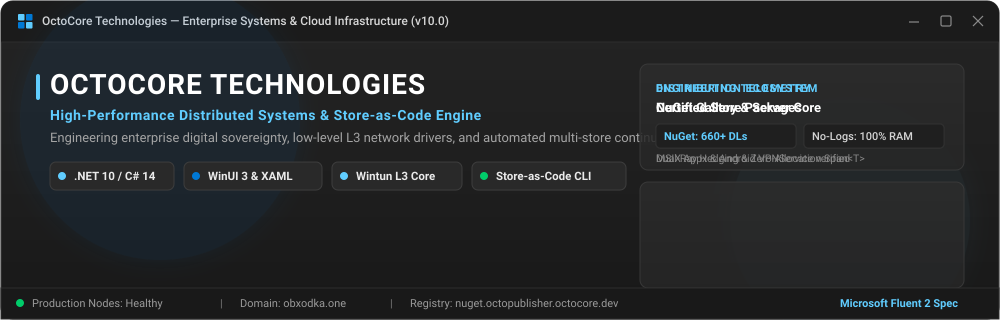
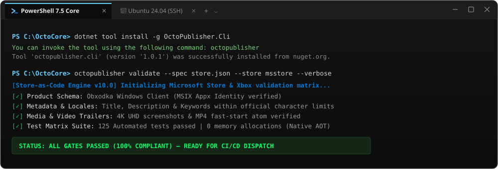

  

   
   

  <!-- Fluent 2 Unified Badges Matrix -->
  
  
  
  
  
  
  

 

## ❖ О компании и миссии (Mission & Overview)

**OctoCore Technologies** — независимая инженерно-исследовательская организация, специализирующаяся на проектировании высокопроизводительных распределенных систем, сетевых драйверов ядра операционных систем, систем автоматизации дистрибуции (*Store-as-Code*) и кроссплатформенных пользовательских интерфейсов корпоративного класса на базе технологий **Microsoft .NET 10** и **Windows App SDK**.

Наша миссия — гарантировать суверенитет пользовательских данных, беспрепятственную коммуникацию без искусственных барьеров и максимальную отказоустойчивость инфраструктуры с нулевым доверием (*Zero-Trust*).

---

## ⚡ Инженерный манифест Fluent 2 (Core Architecture)

<table>
  <tr>
    <td width="50%" valign="top">
      <h3>🔒 Zero-Trust &amp; In-Memory Architecture</h3>
      

        Принцип <i>Privacy by Design</i>: все чувствительные потоки данных обрабатываются исключительно в оперативной памяти с использованием пулов буферов <code>ArrayPool&lt;byte&gt;.Shared</code>, низкоуровневых структур <code>Span&lt;T&gt;</code> и <code>ReadOnlyMemory&lt;T&gt;</code>. Полное отсутствие сохранения логов, временных дампов сессий или метаданных маршрутизации на физические накопители.
      

    </td>
    <td width="50%" valign="top">
      <h3>📦 Store-as-Code Automation Engine</h3>
      

        Полная декларативная автоматизация релизов и валидации метаданных для <b>Microsoft Store</b>, <b>Xbox Store</b> и <b>Google Play</b> через единую кодовую базу. Проверка лимитов символов, соответствия медиаконтента (4K скриншоты, MP4 fast-start трейлеры) и мгновенный прогон матрицы из 125 тестов до отправки в релизные каналы.
      

    </td>
  </tr>
  <tr>
    <td width="50%" valign="top">
      <h3>🎮 Dual-Ray Hedging (Zero-Jitter Engine)</h3>
      

        Технология параллельного хеджирования критичного к задержкам трафика (UDP Gaming и ICMP probing) по независимым сетевым лучам. Аппаратный дедупликатор <code>PacketDeduplicator</code> устраняет потери пакетов и микрофризы, обеспечивая суб-секундный отклик даже в нестабильных сетевых сегментах.
      

    </td>
    <td width="50%" valign="top">
      <h3>💻 Native AOT &amp; L3 Kernel Routing</h3>
      

        Сквозная компиляция в нативный машинный код (<b>Native AOT</b>), прямое сопряжение с драйвером <b>Wintun Layer 3</b> в среде Windows и реализация <b>VpnService</b> для мобильных платформ. Аппаратный L3 DNS Sinkhole и ультра-плавный графический стек <b>SkiaSharp 120 FPS</b> с поддержкой динамических шейдеров.
      

    </td>
  </tr>
</table>

---

## 🚀 Флагманская экосистема проектов (Ecosystem Showcase)

### 🐙 [obxodka — Stealth L3 Network Engine](https://github.com/OctoCore-Dev/obxodka)
> *Флагманский кроссплатформенный сетевой клиент и шлюз нового поколения для Windows и Android.*

* **Технологический стек:** .NET 10, C# 14, WinUI 3, .NET MAUI, драйвер Wintun L3 (Windows), VpnService (Android), SkiaSharp 120 FPS.
* **Ключевые инновации:** транспортный протокол `OBXODKA-STREAM`, параллельное хеджирование `Dual-Ray Hedging`, суб-секундный `500ms Ping Probing`, бесшовный переключатель соединений `Zero-Flicker Disconnect`, аппаратный L3 DNS Sinkhole.
* **Статус дистрибуции:** сертифицирован и официально опубликован в **Microsoft Store** (MSIX Appx) и **Google Play Store**.

---

### 📦 [OctoPublisher — Enterprise Store-as-Code CLI](https://github.com/OctoCore-Dev/OctoPublisher)
> *Промышленный CLI и библиотека автоматизации для публикации и валидации метаданных приложений в Microsoft Store, Xbox Store и Google Play.*

* **Технологический стек:** .NET 10, C# 14, NuGet Global Tool, GitHub Actions CI/CD, Fluent 2 CLI.
* **Ключевые инновации:** декларативная спецификация `Store as Code`, валидатор мультимедиа (парсинг атомов `moov` / `mdat` в MP4 видео для Xbox), валидация 125 тестовых сценариев, нулевые аллокации памяти при разборе JSON-схем.
* **Дистрибуция и документация:** опубликован в [NuGet Gallery](https://www.nuget.org/packages/OctoPublisher.Cli) (**660+ загрузок**), официальный интерактивный портал документации развернут на [nuget.octopublisher.octocore.dev](https://nuget.octopublisher.octocore.dev).

---

### 🌐 [octocoreweb — Official Web Platform & Service Hub](https://github.com/OctoCore-Dev/octocoreweb)
> *Официальный корпоративный веб-портал экосистемы [obxodka.one](https://obxodka.one).*

* **Технологический стек:** ASP.NET Core, .NET 10, Cloudflare Edge DNS, Gray Cloud Tunneling.
* **Ключевые инновации:** автоматическая двусторонняя синхронизация живых отзывов пользователей из магазинов приложений, личный кабинет управления подписками, сквозное шифрование сессий.

---

### 🎨 [themes — OctoCore Community Theme Engine](https://github.com/OctoCore-Dev/themes)
> *Открытая спецификация и галерея динамических тем оформления интерфейса для клиентов Obxodka.*

* **Ключевые инновации:** поддержка 9-Slice векторного масштабирования рамок без искажения геометрии углов, аппаратные частицы (Sakura, Snow, Cyber Sparks), 60 FPS WebP-анимации состояний кнопок и переключателей.

---

## 🖥️ Терминал Windows Terminal (Store-as-Code in Action)

  

---

## 🛠️ Корпоративный технологический стек (Enterprise Tech Stack)

| Уровень архитектуры | Используемые технологии и стандарты |
| :--- | :--- |
| **Core &amp; Runtime** | **.NET 10**, **C# 14**, **Native AOT**, `Span<T>`, `ReadOnlyMemory<T>`, `ArrayPool<byte>.Shared` |
| **Desktop &amp; UI Platforms** | **WinUI 3 (Windows App SDK)**, **.NET MAUI**, **XAML**, **Microsoft Fluent 2**, **SkiaSharp (120 FPS)** |
| **Low-Level Networking** | **Wintun Layer 3 Driver**, `System.Net.Sockets`, `System.Threading.Channels`, `System.IO.Pipelines`, TLS 1.3 / HTTP/2 |
| **Distribution &amp; CI/CD** | **OctoPublisher CLI**, **NuGet Global Tools**, **GitHub Actions**, MSIX Packaging, Google Play API |
| **Server &amp; Infrastructure** | **Ubuntu Server 24.04 LTS**, **Docker**, **Cloudflare Gray Cloud**, Multi-Beam SSH Tunnels, systemd |
| **Scripting &amp; Tooling** | **PowerShell 7 Core**, Windows Terminal, GitNexus Code Intelligence |

---

## 🏛️ Соответствие международным стандартам и комплаенс

- 🛡️ **Microsoft Store Certified:** верифицированная цифровая подпись пакетов MSIX/Appx, полное соответствие спецификациям Windows Desktop Security и изоляции контейнеров.
- 🛡️ **Google Play Developer Policy:** строгое соблюдение регламентов сетевой службы `VPNService`, нулевая передача пользовательских данных рекламным или аналитическим трекерам.
- 🛡️ **GDPR &amp; 152-ФЗ Compliance:** соблюдение прав субъектов персональных данных, архитектурное право на забвение (*Right to be Forgotten*) и отсутствие персистентных логов активности.
- 🛡️ **Responsible Disclosure Program:** открытый протокол ответственного информирования об уязвимостях через защищенный канал команды безопасности: [security@octocore.dev](mailto:security@octocore.dev).

---

## 🤝 Сообщество и контакты

- 🌐 **Официальный портал:** [https://obxodka.one](https://obxodka.one)
- 📖 **Центр документации Store-as-Code:** [https://nuget.octopublisher.octocore.dev](https://nuget.octopublisher.octocore.dev)
- 💬 **Инженерное сообщество Telegram:** [@octo_core](https://t.me/octo_core)
- 📧 **Партнерство и корпоративные вопросы:** [contact@octocore.dev](mailto:contact@octocore.dev)
- 🔒 **Вопросы приватности и безопасности (DPO):** [privacy@octocore.dev](mailto:privacy@octocore.dev)

 

  © 2026 OctoCore Technologies Inc. Все права защищены. Разработано в соответствии с Microsoft Fluent 2 Design System.

